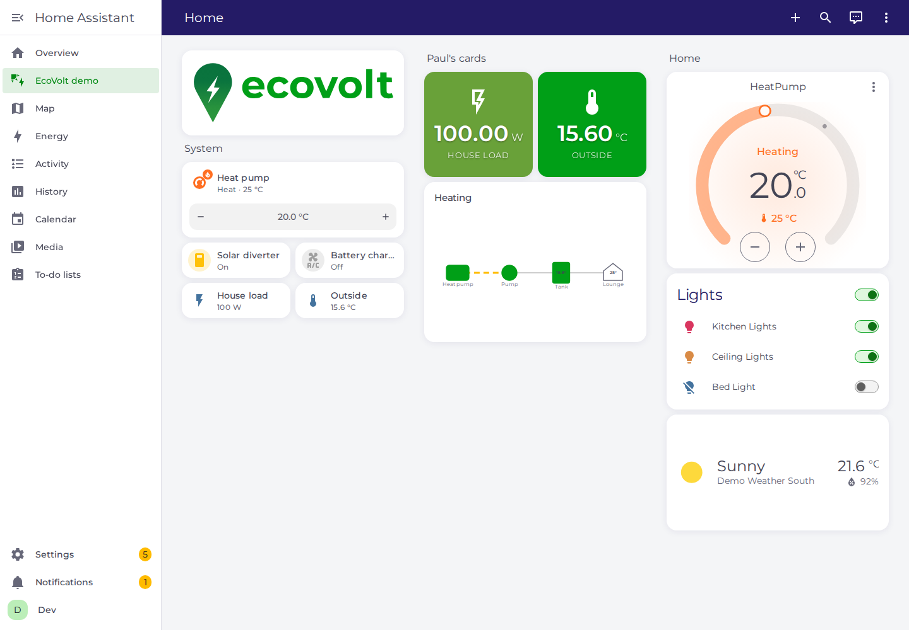
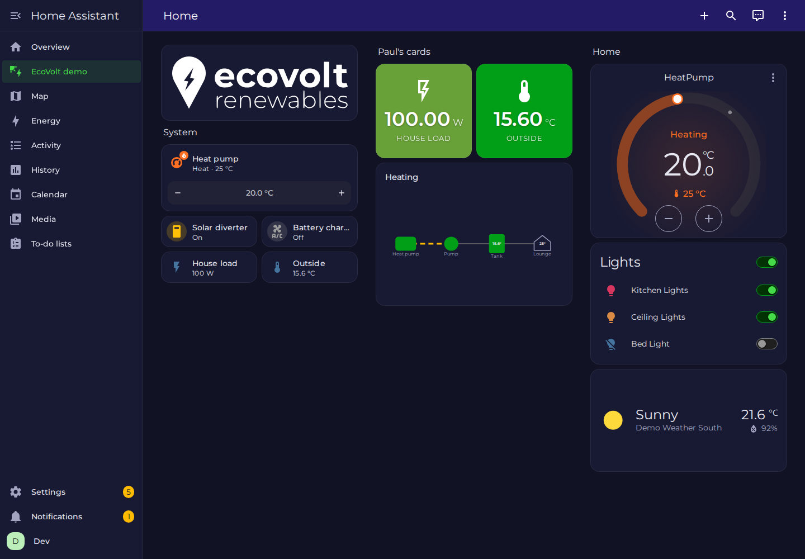

# EcoVolt theme for Home Assistant

> **Private use only.** All rights reserved. Use requires permission, see [Licence](#licence).

Brand theme for Home Assistant installs by EcoVolt Renewables: brand green, navy and amber, the Montserrat font, and the EcoVolt logo, with light and dark modes.

| Light | Dark |
|---|---|
|  |  |

## What's included

| Path | What it is |
|---|---|
| `themes/ecovolt.yaml` | The theme. Sets colours, font, card style and energy colours (solar is amber, battery green, grid navy) |
| `www/ecovolt/ecovolt-fonts.js` | Loads the self-hosted Montserrat font, so it works without internet access |
| `www/ecovolt/ecovolt-logo.svg`, `-white.svg` | Logo, tightly cropped: colour version for light backgrounds (green "ecovolt", navy "renewables"), white version for dark |
| `www/ecovolt/ecovolt-banner.svg`, `-white.svg` | Same logos with padding, for dashboard header cards |
| `www/ecovolt/ecovolt-mark.svg` | Pin icon only, square |
| `examples/dashboard-header.yaml` | Logo header card that switches logo with light/dark mode |

## Install and update

Written for Raspberry Pis running **Home Assistant OS**. Install on site, and after that every update happens remotely through the web UI. You never need SSH or file-share access.

In short:

1. Install the theme from **Settings → Marketplace → Add from link** (`keteracel/ecovolt-ha-theme`, type **Theme**). This needs Home Assistant 2026.11 or later.
2. Paste [`examples/configuration.yaml`](examples/configuration.yaml) into `configuration.yaml` with the File editor add-on, then restart.
3. Run the **`shell_command.ecovolt_update_assets`** action to download the font and logos, then restart once more.
4. Run `frontend.set_theme` with `name: EcoVolt`, and again with `mode: dark`.
5. Add the logo card from [`examples/dashboard-header.yaml`](examples/dashboard-header.yaml).

Updates: theme changes come through **Settings → Updates**. For font or logo changes, re-run the asset action and bump the `?v=` number.

For the full steps, troubleshooting and removal, see the **[Installation and update guide](INSTALL.md)**.

The sidebar title ("Home Assistant") can't be replaced by a theme. If a customer wants the logo there too, [custom-sidebar](https://github.com/elchininet/custom-sidebar) or card-mod can do it.

## Accessibility

Brand green `#009f17` reaches 3.5:1 against white. That's fine for icons, toggles and large shapes, but too low for small text. So links, the selected sidebar item, and text on filled buttons use a darker green, `#028813`. Check every text/background pair after changing colours:

```sh
make check
```

## Previewing changes

`make screenshots` starts a throwaway Home Assistant in Docker with the demo integration, applies the theme in light and dark mode, and checks:

- the colours, font and logo actually applied;
- the font actually loaded.

It then saves screenshots to `docs/screenshots/`. To include [Paul's custom cards](https://github.com/keteracel/pauls-custom-cards) in the preview, build them first and run:

```sh
PAULS_CARDS_JS=/path/to/pauls-custom-cards/dist/pauls-cards.js make screenshots
```

Use `make dev` to poke around at http://localhost:8123 (user `dev`, password `dev-password`, created by `make screenshots`), and `make dev-down` to remove it.

## Releasing

Customers' Pis are offered releases, not individual commits. To publish a change, run this from a clean `main`:

```sh
make release VERSION=v0.2.0 NOTES_FILE=/tmp/notes.md
```

It runs the contrast check, tags the release, and attaches `ecovolt-assets.tar.gz`, the font and logos that the `ecovolt_update_assets` action downloads. In the notes, say whether the font or logos changed. If they did, installs need the asset action and a `?v=` bump (see [Updating](INSTALL.md#updating-remotely)).

## Licence

**Not licensed for public use.** This repo is public only so that EcoVolt installs can get it and update it through Home Assistant's Marketplace. Any use needs prior written permission, see [`LICENSE`](LICENSE). The EcoVolt name and logos are EcoVolt Renewables' brand marks, used with permission. The Montserrat font files are under the SIL Open Font License, see [NOTICE.md](NOTICE.md).
